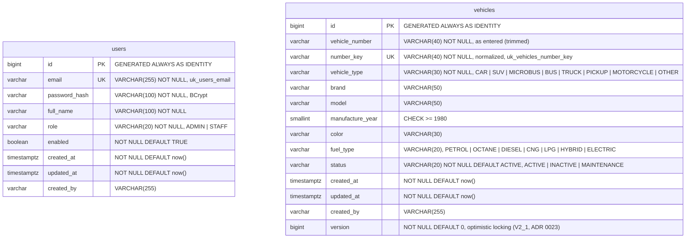

# ER diagram — v1.1

The v1.1 schema, exactly as created by the Flyway migrations
`V1__create_users.sql`, `V2__create_vehicles.sql` and `V2_1__add_vehicle_version.sql` (v1.1) in
[`stark-vms-backend/src/main/resources/db/migration`](../src/main/resources/db/migration/).

Notes:

- There is no foreign key between the two tables in v1.0. `vehicles.created_by` holds the email of
  the user who created the row (audit, FR-X01) as text, not a reference to `users.id`.
- BR-01 (unique vehicle number): `vehicle_number` keeps the value as entered; `number_key` is the
  normalized form (trimmed, upper case, spaces and hyphens removed) and carries the `UNIQUE`
  constraint, so `DHK-1234` and `dhk 1234` cannot both exist.
- Enum-like columns are `VARCHAR` with a `CHECK` constraint (`ck_users_role`, `ck_vehicles_status`,
  `ck_vehicles_vehicle_type`, `ck_vehicles_fuel_type`, `ck_vehicles_manufacture_year`).
- Indexes: `idx_vehicles_status (status)` and `idx_vehicles_created_at (created_at DESC)` (default
  list order).
- `vehicles.version` (V2_1) is the JPA `@Version` column: Hibernate increments it on every change and adds
  `WHERE version = ?` to each `UPDATE`; the API returns it and requires it in `PUT /vehicles/{id}` (contract 6.2).
- The first ADMIN user is created at start-up from environment variables, never by a migration.
