# ER diagram — v2.1

The v2.1 schema, exactly as created by the Flyway migrations `V1__create_users.sql` …
`V8__add_users_tokens_revoked_at.sql` in
[`stark-vms-backend/src/main/resources/db/migration`](../src/main/resources/db/migration/).
V1 and V2 are the unchanged v1.0 tables; V2_1 (`vehicles.version`, byte-identical to v1.1) and V3–V6 follow; V7 (the other `version` columns, `users.password_changed_at`,
ADRs 0023 / 0024) and V8 (`users.tokens_revoked_at`, security review of 2026-11-08) are the v2.1 hardening.

```mermaid
erDiagram
    vehicles ||--o{ vehicle_driver_assignments : "has (history)"
    drivers ||--o{ vehicle_driver_assignments : "drives (history)"
    vehicles ||--o{ vehicle_documents : has
    vehicles ||--o{ maintenance_records : has
    vehicle_documents |o--o| stored_files : "storage_key (no FK)"

    users {
        bigint id PK "GENERATED ALWAYS AS IDENTITY"
        varchar email UK "VARCHAR(255) NOT NULL"
        varchar password_hash "VARCHAR(100) NOT NULL, BCrypt"
        varchar full_name "VARCHAR(100) NOT NULL"
        varchar role "VARCHAR(20) NOT NULL, ADMIN | STAFF"
        boolean enabled "NOT NULL DEFAULT TRUE"
        timestamptz password_changed_at "V7, NULL = never; older tokens rejected"
        timestamptz tokens_revoked_at "V8, set on disable; older tokens rejected"
        bigint version "V7, NOT NULL DEFAULT 0, JPA @Version"
        timestamptz created_at "NOT NULL DEFAULT now()"
        timestamptz updated_at "NOT NULL DEFAULT now()"
        varchar created_by "VARCHAR(255)"
    }
    vehicles {
        bigint id PK "GENERATED ALWAYS AS IDENTITY"
        varchar vehicle_number "VARCHAR(40) NOT NULL, as entered (trimmed)"
        varchar number_key UK "VARCHAR(40) NOT NULL, normalized"
        varchar vehicle_type "VARCHAR(30) NOT NULL, CAR | SUV | MICROBUS | BUS | TRUCK | PICKUP | MOTORCYCLE | OTHER"
        varchar brand "VARCHAR(50)"
        varchar model "VARCHAR(50)"
        smallint manufacture_year "CHECK >= 1980"
        varchar color "VARCHAR(30)"
        varchar fuel_type "VARCHAR(20), PETROL | OCTANE | DIESEL | CNG | LPG | HYBRID | ELECTRIC"
        varchar status "VARCHAR(20) NOT NULL DEFAULT ACTIVE, ACTIVE | INACTIVE | MAINTENANCE"
        bigint version "V2_1, NOT NULL DEFAULT 0, JPA @Version"
        timestamptz created_at "NOT NULL DEFAULT now()"
        timestamptz updated_at "NOT NULL DEFAULT now()"
        varchar created_by "VARCHAR(255)"
    }
    drivers {
        bigint id PK "GENERATED ALWAYS AS IDENTITY"
        varchar full_name "VARCHAR(100) NOT NULL"
        varchar phone UK "VARCHAR(20) NOT NULL, normalized, e.g. 01711000001"
        varchar license_number "VARCHAR(40) NOT NULL, as entered (trimmed)"
        varchar license_key UK "VARCHAR(40) NOT NULL, normalized"
        date license_expiry "NOT NULL"
        varchar status "VARCHAR(20) NOT NULL DEFAULT ACTIVE, ACTIVE | INACTIVE"
        bigint version "V7, NOT NULL DEFAULT 0, JPA @Version"
        timestamptz created_at "NOT NULL DEFAULT now()"
        timestamptz updated_at "NOT NULL DEFAULT now()"
        varchar created_by "VARCHAR(255)"
    }
    vehicle_driver_assignments {
        bigint id PK "GENERATED ALWAYS AS IDENTITY"
        bigint vehicle_id FK "NOT NULL, ON DELETE RESTRICT"
        bigint driver_id FK "NOT NULL, ON DELETE RESTRICT"
        timestamptz assigned_at "NOT NULL"
        timestamptz unassigned_at "NULL = current; CHECK >= assigned_at"
        timestamptz created_at "NOT NULL DEFAULT now()"
        timestamptz updated_at "NOT NULL DEFAULT now()"
        varchar created_by "VARCHAR(255)"
    }
    stored_files {
        bigint id PK "GENERATED ALWAYS AS IDENTITY"
        varchar storage_key UK "VARCHAR(100) NOT NULL"
        varchar content_type "VARCHAR(100) NOT NULL"
        bigint file_size "NOT NULL, CHECK >= 0"
        bytea data "NOT NULL"
        timestamptz created_at "NOT NULL DEFAULT now()"
        timestamptz updated_at "NOT NULL DEFAULT now()"
        varchar created_by "VARCHAR(255)"
    }
    vehicle_documents {
        bigint id PK "GENERATED ALWAYS AS IDENTITY"
        bigint vehicle_id FK "NOT NULL, ON DELETE RESTRICT"
        varchar document_type "VARCHAR(30) NOT NULL, REGISTRATION | TAX_TOKEN | INSURANCE | FITNESS_CERTIFICATE | ROUTE_PERMIT | OTHER"
        varchar document_number "VARCHAR(60)"
        date issue_date
        date expiry_date "NOT NULL, CHECK >= issue_date"
        varchar storage_key UK "VARCHAR(100) NOT NULL, random UUID"
        varchar file_name "VARCHAR(255) NOT NULL, sanitized original name"
        varchar content_type "VARCHAR(100) NOT NULL"
        bigint file_size "NOT NULL, CHECK > 0"
        timestamptz created_at "NOT NULL DEFAULT now()"
        timestamptz updated_at "NOT NULL DEFAULT now()"
        varchar created_by "VARCHAR(255)"
    }
    maintenance_records {
        bigint id PK "GENERATED ALWAYS AS IDENTITY"
        bigint vehicle_id FK "NOT NULL, ON DELETE RESTRICT"
        date service_date "NOT NULL"
        varchar maintenance_type "VARCHAR(30) NOT NULL, ROUTINE_SERVICE | OIL_CHANGE | TYRE | BRAKE | ENGINE | ELECTRICAL | BODY_WORK | INSPECTION | REPAIR | OTHER"
        numeric cost "NUMERIC(12,2) NOT NULL, BDT, CHECK >= 0"
        varchar vendor_name "VARCHAR(100)"
        integer odometer_km "CHECK >= 0"
        varchar notes "VARCHAR(1000)"
        bigint version "V7, NOT NULL DEFAULT 0, JPA @Version"
        timestamptz created_at "NOT NULL DEFAULT now()"
        timestamptz updated_at "NOT NULL DEFAULT now()"
        varchar created_by "VARCHAR(255)"
    }
```

Notes:

- `users` has no foreign keys: `created_by` on every table holds the creator's email as text
  (audit, FR-X01).
- All foreign keys are `ON DELETE RESTRICT`, so history never disappears silently (BR-10): a
  vehicle with assignments, documents or maintenance records cannot be deleted.
- BR-06: the partial unique indexes `uq_assignment_open_vehicle (vehicle_id)` and
  `uq_assignment_open_driver (driver_id)`, both `WHERE unassigned_at IS NULL`, allow at most one
  current assignment per vehicle and per driver. Changing a driver closes the open row and inserts
  a new one.
- `vehicle_documents.storage_key` has no foreign key to `stored_files`: with
  `app.storage.provider=supabase` the bytes live outside PostgreSQL and `stored_files` stays empty;
  `DocumentService` deletes the stored file together with the document.
- Document expiry status (VALID / EXPIRING_SOON / EXPIRED, BR-08) is never stored; it is computed
  from `expiry_date` on every read.
- Indexes: `idx_vehicles_status`, `idx_vehicles_created_at (created_at DESC)`,
  `idx_drivers_full_name`, `idx_drivers_license_expiry`,
  `idx_assignments_vehicle_assigned_at (vehicle_id, assigned_at DESC)`,
  `idx_assignments_driver_assigned_at (driver_id, assigned_at DESC)`,
  `idx_vehicle_documents_expiry_date`, `idx_vehicle_documents_vehicle (vehicle_id, expiry_date)`,
  `idx_maintenance_vehicle_service_date (vehicle_id, service_date DESC)`,
  `idx_maintenance_service_date`.
